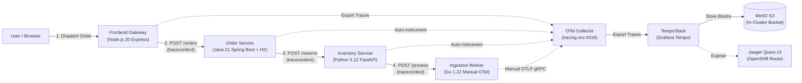

# Enterprise Distributed Observability on Red Hat OpenShift Local (4.20.x)

[](https://www.redhat.com/en/technologies/cloud-computing/openshift)
[](https://opentelemetry.io/)
[](https://grafana.com/oss/tempo/)
[-EE0000.svg)](https://developers.redhat.com/products/openshift-local/overview)

A complete, production-grade enterprise distributed tracing and observability tutorial workspace tailored for **Red Hat OpenShift Local (formerly CRC / CodeReady Containers) on OpenShift 4.20.x**.

This demo proves that engineers and architects do not need an expensive multi-node cloud cluster to master enterprise distributed tracing, OpenTelemetry auto-instrumentation, and Grafana Tempo.

---

## Architecture Overview

The demo deploys a **4-tier polyglot microservice architecture** executing an end-to-end distributed transaction with automatic W3C `traceparent` context propagation:



### Microservice Tier Breakdown
1. **Frontend Gateway (`services/frontend-node`)**:
   - Node.js 20 + Express + EJS.
   - Beautiful dark-mode dashboard with real-time transaction telemetry, latency timer, SLA breach indicator, and direct Jaeger deep links.
   - Enforces a strict 3,000ms SLA timeout (returns HTTP 504 on breach).
   - Auto-instrumented via OpenTelemetry Operator (`inject-nodejs: "true"`).
2. **Order Service (`services/order-java`)**:
   - Java 21 + Spring Boot 3 + Spring Data JPA.
   - In-memory H2 database; tuned heap limits (`-Xms64m -Xmx192m -XX:+UseSerialGC`) for low CRC memory overhead.
   - Auto-instrumented via OpenTelemetry Operator (`inject-java: "true"`).
3. **Inventory Service (`services/inventory-python`)**:
   - Python 3.12 + FastAPI + Async HTTP (`httpx`).
   - Asynchronous reservation endpoint.
   - Auto-instrumented via OpenTelemetry Operator (`inject-python: "true"`).
4. **Worker / Ingestion Service (`services/worker-go`)**:
   - Go 1.22 compiled single binary (< 15MB RAM).
   - Manual OpenTelemetry SDK setup (`sdktrace.TracerProvider`, `otelhttp` middleware, OTLP gRPC exporter).
   - Injects custom child spans (`validate_inventory_allocation`, `record_ledger_entry`, `dispatch_fulfillment`).
   - Hosts the **Chaos Latency Switch**: when enabled, simulates an artificial 4-second delay.

---

## Directory Structure

```text
openshift-observability/
├── README.md                               # Project documentation & architecture
├── RUNBOOK.md                              # Comprehensive local runbook for OpenShift Local
├── YOUTUBE_SCRIPT.md                       # Two-column spoken narration script for recording
├── scripts/
│   ├── setup-crc.sh                        # CRC memory (16GB), CPU (6), and disk setup
│   ├── deploy-all.sh                       # One-click deployment script
│   ├── build-images.sh                     # In-cluster OpenShift binary builds or local podman
│   └── test-traffic.sh                     # Automated curl test (happy path + 504 chaos bug)
├── manifests/
│   ├── 00-cluster-monitoring/
│   │   └── cluster-monitoring-config.yaml  # Enables User Workload Monitoring in CRC
│   ├── 01-operators/
│   │   ├── 01-namespaces.yaml              # Namespaces for operators and tracing
│   │   ├── 02-operator-group.yaml          # OperatorGroups for OLM
│   │   └── 03-subscriptions.yaml           # Subscriptions for OTel and Tempo operators
│   ├── 02-minio/
│   │   ├── 01-minio.yaml                   # MinIO PVC, Deployment, Service & Bucket Init Job
│   │   └── 02-tempo-s3-secret.yaml         # S3 secret with MinIO credentials for Tempo
│   ├── 03-tracing/
│   │   ├── 01-tempostack.yaml              # TempoStack CR (single-tenant, route enabled)
│   │   ├── 02-otel-collector.yaml          # OpenTelemetryCollector CR
│   │   └── 03-instrumentation.yaml         # Instrumentation CR (Node, Java, Python)
│   └── 04-apps/
│       ├── 00-namespace.yaml               # Application namespace (observability-demo)
│       ├── 01-go-worker.yaml               # Go Worker Deployment & Service
│       ├── 02-python-inventory.yaml        # Python Inventory Deployment & Service
│       ├── 03-java-order.yaml              # Java Order Deployment & Service
│       ├── 04-nodejs-frontend.yaml         # Node.js Frontend Deployment, Service & Route
│       └── 05-service-monitor.yaml         # ServiceMonitors for User Workload Monitoring
└── services/
    ├── frontend-node/                      # Node.js 20 Express Web Gateway
    ├── order-java/                         # Java 21 Spring Boot 3 + H2
    ├── inventory-python/                   # Python 3.12 FastAPI
    └── worker-go/                          # Go 1.22 Manual OTel SDK
```

---

## Quickstart Guide

### 1. Configure & Start OpenShift Local (CRC)
Assign the required resources (16 GB RAM and 6 vCPUs recommended):

```bash
./scripts/setup-crc.sh
crc setup
crc start -p /path/to/pull-secret.txt
eval $(crc oc-env)
oc login -u kubeadmin https://api.crc.testing:6443
```

### 2. Build Microservice Images
Use OpenShift's native in-cluster Binary BuildConfigs (no local compilers or Docker needed):

```bash
./scripts/build-images.sh oc-build
```

### 3. Deploy the Tracing Stack & Applications
Deploy User Workload Monitoring, MinIO, TempoStack, OpenTelemetry Collector, and the microservices:

```bash
./scripts/deploy-all.sh
```

---

## Live Troubleshooting Demonstration

### Normal Execution (Happy Path)
1. Open the Frontend UI route in your browser:
   `https://frontend-observability-demo.apps-crc.testing`
2. Leave "Inject 4-Second Latency Bug" **OFF**.
3. Click **Execute Polyglot Transaction**.
4. Result: **HTTP 200 OK** in ~60ms. Click the generated link to inspect the 4-tier waterfall trace in Tempo / Jaeger.

### Chaos Failure (The 4-Second Bottleneck)
1. In the Frontend UI, toggle **Inject 4-Second Latency Bug** to **ON**.
2. Click **Execute Polyglot Transaction**.
3. Execution path hangs in `worker-go` for 4,000ms.
4. The Node.js frontend breaches its 3,000ms SLA timeout and aborts downstream sockets, throwing **HTTP 504 Gateway Timeout**.
5. **The Diagnostic Trail:**
   - **Metrics Spike:** View the immediate jump in 504 rates and p99 latency in OpenShift Console (`Observe -> Metrics`).
   - **Correlate Trace:** Copy the Trace ID from the frontend error card.
   - **Root Cause Isolation:** Open the Tempo / Jaeger UI and search for the Trace ID. Expand the waterfall trace: the root span was canceled after 3.0s, but tier 4 (`worker-go`) shows `dispatch_fulfillment` stalled for 4.00s with the span event `latency_chaos_injected`.

---

## Documentation Links
* [Local Runbook (RUNBOOK.md)](RUNBOOK.md) - Detailed step-by-step CLI commands, operator health checks, and CRC resource tuning.
* [YouTube Narration Script (YOUTUBE_SCRIPT.md)](YOUTUBE_SCRIPT.md) - Complete two-column spoken-word script formatted for video recording.
